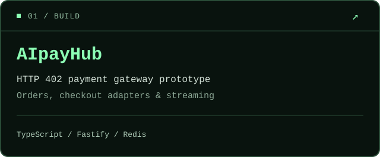
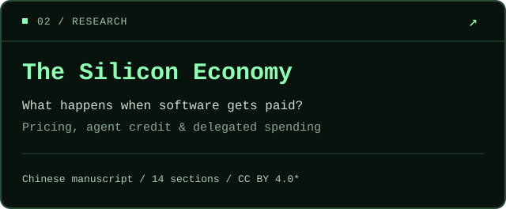

  

[中文](README.md) | [English](README.en.md)

### 01 / whoami

Independent developer exploring agent payments, the machine economy, and creative automation. I like understanding systems and turning ideas into small working tools.

### 02 / selected work

  
  

**[AI-Pay Hub](https://github.com/summerain0401/AiPayHub)** — an experimental HTTP 402 gateway exploring per-use billing, order state, streaming proxying, and Alipay WAP payment. Payment and administrator improvements remain under review in [PR #1](https://github.com/summerain0401/AiPayHub/pull/1).

**[The Silicon Economy](https://github.com/summerain0401/The-Silicon-Economy)** — fourteen Chinese texts about machine-readable prices, agent credit, markets, and spending accountability. Original main-text portions use CC BY 4.0 within the documented scope.

**Creative corner:** [gbro-cover-design](https://github.com/summerain0401/gbro-cover-design), a cover-prompt workflow forked from [pyang5166](https://github.com/pyang5166/gbro-cover-design).

### Project navigation

Public projects by purpose. Repository READMEs provide Chinese and English entry points with implementation status and limits.

| Area | Projects |
| --- | --- |
| Agents and payments | [AiPayHub](https://github.com/summerain0401/AiPayHub) · [Flop](https://github.com/summerain0401/Flop) |
| Creative tools | [kcard](https://github.com/summerain0401/kcard) · [videoMaker](https://github.com/summerain0401/videoMaker) · [videoShort](https://github.com/summerain0401/videoShort) · [story-to-handdrawn-video](https://github.com/summerain0401/story-to-handdrawn-video) · [gbro-cover-design](https://github.com/summerain0401/gbro-cover-design) |
| Trading research | [HyperTradeSystem](https://github.com/summerain0401/HyperTradeSystem) · [4h-trading-system](https://github.com/summerain0401/4h-trading-system) |
| Content and writing | [The Silicon Economy](https://github.com/summerain0401/The-Silicon-Economy) · [media](https://github.com/summerain0401/media) · [Less](https://github.com/summerain0401/Less) |

Trading and payment projects are experiments; consult each README for its actual scope. Public visibility does not mean every repository grants an open-source reuse license.

### 03 / toolbox

`TypeScript` · `Node.js` · `Fastify` · `Redis` · `Vitest` · `Git`

### 04 / connect

Happy to discuss agent payments, API design, machine economics, and creative tools. Use the relevant repository's issues for project questions and improvements.

[X / @summerain0401](https://x.com/summerain0401) · [Email](mailto:summerain0401@gmail.com) · [All public repositories](https://github.com/summerain0401?tab=repositories)

---

stay curious. make it work. make it clear.
