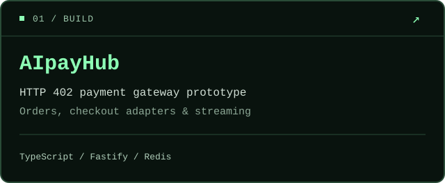
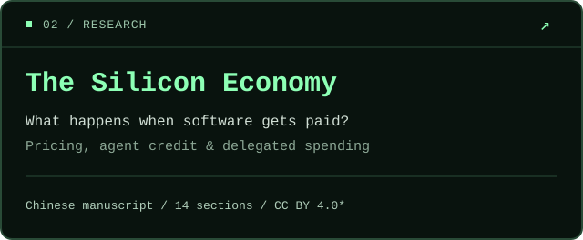

<p>
  
</p>

<p align="center">
  <a href="https://github.com/summerain0401/AiPayHub">AIpayHub</a> &nbsp; / &nbsp;
  <a href="https://github.com/summerain0401/The-Silicon-Economy">The Silicon Economy</a> &nbsp; / &nbsp;
  <a href="https://x.com/summerain0401">X</a>
</p>

### `01` / whoami

独立开发者，关注 **Agent 支付、机器经济与创作自动化**。喜欢拆解系统，也喜欢把想法做成可以运行的小工具。

Independent developer exploring how agents use services, how software gets paid, and how creative work can be automated.

```js
const summerRain = {
  role: "independent developer",
  building: ["agent payments", "creative tools"],
  writing: "The Silicon Economy",
  approach: "small experiments, steady iteration"
};
```

### `02` / selected work

<p>
  <a href="https://github.com/summerain0401/AiPayHub"></a>
  <a href="https://github.com/summerain0401/The-Silicon-Economy"></a>
</p>

**[AIpayHub](https://github.com/summerain0401/AiPayHub)** — 按次付费网关原型，探索 HTTP 402、订单状态与流式代理，包含 Alipay WAP 支付适配。改进内容在 [PR #1](https://github.com/summerain0401/AiPayHub/pull/1) 审阅中。

**[《硅基经济学》](https://github.com/summerain0401/The-Silicon-Economy)** — 从机器可读报价与微支付，讨论 Agent 信用、市场结构和支出责任。14 篇中文正文；*原创正文采用 CC BY 4.0，授权范围见仓库说明。

**Creative corner** — [gbro-cover-design](https://github.com/summerain0401/gbro-cover-design)：封面提示词与创作工作流实验，fork 自 [pyang5166](https://github.com/pyang5166/gbro-cover-design)。

### `03` / toolbox

`TypeScript` &nbsp; `Node.js` &nbsp; `Fastify` &nbsp; `Redis` &nbsp; `Vitest` &nbsp; `Git`

### `04` / connect

欢迎交流 Agent 支付、API 设计、机器经济与创作工具。项目问题和改进建议，可以在对应仓库的 Issues 里聊。

[X / @summerain0401](https://x.com/summerain0401) &nbsp; · &nbsp; [Email](mailto:summerain0401@gmail.com) &nbsp; · &nbsp; [All public repositories](https://github.com/summerain0401?tab=repositories)

---

<p align="center"><sub>stay curious. make it work. make it clear.</sub></p>
